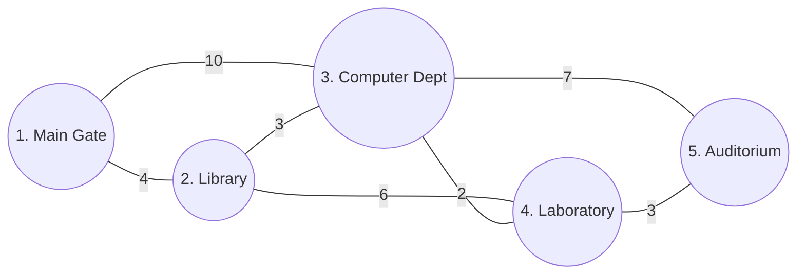

# Campus Shortest Route Finder (PBLE 2 – Dijkstra's Algorithm)

> **Course:** Data Structures & Algorithms Laboratory  
> **Level:** 2nd Year B.Tech / B.E. Computer Science & Engineering  
> **Topic:** Graph Theory, Adjacency Matrix Representation & Dijkstra's Shortest Path Algorithm  
> **Language:** C (Standard C99)

---

## 📌 Project Overview

Navigating across a large college campus efficiently between key landmarks—such as the **Main Gate**, **Library**, **Computer Department**, **Laboratory**, and **Auditorium**—is a classic real-world application of graph theory.

This project implements a menu-driven C application that models a university campus road network as a weighted undirected graph. Using **Dijkstra's Shortest Path Algorithm**, the system allows students and visitors to select any landmark as a starting point (source) and computes the exact shortest distance and path to all other destinations across the campus.

---

## 🎯 Objectives

- **Graph Modeling:** Represent weighted campus road networks using a 2D **Adjacency Matrix** ($V \times V$).
- **Algorithm Implementation:** Implement **Dijkstra's Single-Source Shortest Path Algorithm** using arrays and iterative relaxation loops.
- **Path Reconstruction:** Maintain a **parent/predecessor pointer array** to backtrack and display the exact step-by-step route (`A -> B -> C`).
- **Menu-Driven Interface:** Provide an interactive CLI menu conforming to laboratory guidelines.
- **Complexity Analysis:** Evaluate and justify the time and space complexity ($O(V^2)$).

---

## 🏫 Campus Locations & Graph Model

### 1. Sample Locations

| Vertex No. | Campus Location |
|:----------:|:----------------|
| **1** | Main Gate |
| **2** | Library |
| **3** | Computer Department |
| **4** | Laboratory |
| **5** | Auditorium |

### 2. Network Diagram

```
       [Main Gate]
       /         \
   (4)/           \(10)
     /             \
[Library]--------[Computer Dept]
     \    (3)      /      \
   (6)\        (2)/        \(7)
       \         /          \
      [Laboratory]----------[Auditorium]
                   (3)
```



### 3. Sample Adjacency Matrix

Where `0` denotes self-distance and `INF` (99999) denotes no direct road connection:

| From \ To | Main Gate | Library | Computer Dept | Laboratory | Auditorium |
|:---|:---:|:---:|:---:|:---:|:---:|
| **Main Gate** | 0 | 4 | 10 | INF | INF |
| **Library** | 4 | 0 | 3 | 6 | INF |
| **Computer Dept** | 10 | 3 | 0 | 2 | 7 |
| **Laboratory** | INF | 6 | 2 | 0 | 3 |
| **Auditorium** | INF | INF | 7 | 3 | 0 |

---

## 📜 Program Menu

```text
==================================================
   CAMPUS SHORTEST ROUTE FINDER - DIJKSTRA        
==================================================
 1. Enter Campus Graph
 2. Display Adjacency Matrix
 3. Select Source Location
 4. Find Shortest Distance
 5. Display Shortest Paths
 6. Display Distance from Source to All Locations
 7. Exit
==================================================
```

---

## 💻 Output & Verification (Sample Run)

When the source is set to **Main Gate (Location 1)**, the program computes the following shortest routes:

```text
====================================================================================================
                         SHORTEST PATHS FROM SOURCE: Main Gate
====================================================================================================
Destination              | Shortest Distance | Shortest Path
-------------------------+-------------------+------------------------------------------------------
Library                  | 4                 | Main Gate -> Library
Computer Department      | 7                 | Main Gate -> Library -> Computer Department
Laboratory               | 9                 | Main Gate -> Library -> Computer Department -> Laboratory
Auditorium               | 12                | Main Gate -> Library -> Computer Department -> Laboratory -> Auditorium
====================================================================================================
```

### Distance Summary

| Destination | Shortest Distance | Route Breakdown |
|:---|:---:|:---|
| **Library** | **4** | Main Gate $\rightarrow$ Library ($4$) |
| **Computer Department** | **7** | Main Gate $\rightarrow$ Library ($4$) $\rightarrow$ Computer Dept ($3$) |
| **Laboratory** | **9** | Main Gate $\rightarrow$ Library ($4$) $\rightarrow$ Computer Dept ($3$) $\rightarrow$ Laboratory ($2$) |
| **Auditorium** | **12** | Main Gate $\rightarrow$ Library $\rightarrow$ Computer Dept $\rightarrow$ Laboratory $\rightarrow$ Auditorium ($9 + 3$) |

---

## ⚡ Algorithm & Complexity Analysis

### 1. Algorithm Overview
1. Initialize distance array `dist[]` with `INF`, `visited[]` with `false`, and `parent[]` with `-1`.
2. Set `dist[source] = 0`.
3. Loop $(V - 1)$ times:
   - Find the unvisited vertex $u$ with the minimum tentative distance `dist[u]`.
   - Mark $u$ as visited.
   - For every adjacent vertex $v$ of $u$, perform edge relaxation:
     $$\text{if } \text{dist}[u] + \text{weight}(u, v) < \text{dist}[v] \implies \text{dist}[v] = \text{dist}[u] + \text{weight}(u, v), \quad \text{parent}[v] = u$$
4. Reconstruct paths recursively using `parent[]`.

### 2. Time Complexity: $\mathcal{O}(V^2)$
- **Outer Loop:** Runs $(V - 1)$ times to process each vertex $\rightarrow \mathcal{O}(V)$.
- **Minimum Vertex Search:** Linear scan across the unvisited set in an array takes $\mathcal{O}(V)$.
- **Edge Relaxation:** Iterates across the entire row of the Adjacency Matrix of size $V \rightarrow \mathcal{O}(V)$.
- **Total Time Complexity:**
  $$(V - 1) \times (\mathcal{O}(V) + \mathcal{O}(V)) = \mathcal{O}(V^2)$$

*Justification:* For small to medium-sized college campus graphs ($V \le 50$), an adjacency matrix with $\mathcal{O}(V^2)$ implementation is optimal, memory-friendly, simple to maintain, and avoids the pointer overhead of adjacency lists and binary min-heaps.

### 3. Space Complexity: $\mathcal{O}(V^2)$
- **Adjacency Matrix:** Requires a $V \times V$ matrix $\rightarrow \mathcal{O}(V^2)$.
- **Auxiliary Arrays:** `dist[V]`, `visited[V]`, `parent[V]`, and `locationNames[V]` $\rightarrow \mathcal{O}(V)$.
- **Total Space Complexity:** $\mathcal{O}(V^2)$.

---

## 🛠️ Build & Run Instructions

### Prerequisites
- GCC Compiler (`gcc`)
- Make utility (optional)
- Linux / macOS / Windows (MinGW or WSL)

### Compilation

Using `make`:
```bash
make
```

Or directly with `gcc`:
```bash
gcc -Wall -Wextra -std=c99 -O2 main.c -o campus_route_finder
```

### Execution
```bash
./campus_route_finder
```

Or using `make`:
```bash
make run
```

### Cleanup
```bash
make clean
```

---

## 📁 Repository Structure

```text
.
├── main.c           # Complete C source code (Adjacency Matrix, Dijkstra, Menu CLI)
├── Makefile         # Build automation script
├── README.md        # Project documentation and complexity analysis
└── .gitignore       # Git ignore rules for build binaries
```

---

## 📚 References

1. Thomas H. Cormen, Charles E. Leiserson, Ronald L. Rivest, Clifford Stein. *Introduction to Algorithms (CLRS)*, 3rd Edition — Chapter 24: Single-Source Shortest Paths.
2. Ellis Horowitz, Sartaj Sahni, Susan Anderson-Freed. *Fundamentals of Data Structures in C*, 2nd Edition — Chapter 6: Graphs.
